<h1 align="center"> Hi👋, I'm Matheus Cutrim </h1>

  <b>Computer Science Student at FIAP</b> 
  Dados · Machine Learning · Python · Java · SQL

  
  
  

---

## 🧑‍💻 Sobre mim

Sou estudante de **Ciência da Computação na FIAP** e gosto de transformar dados em respostas para problemas reais. Meus projetos se dão pela minha evolução em estudos acadêmicos e possoais. E dentro deles, atualmente destaco projetos reais utilizando **Machine Learning** (classificação, regressão e seleção de atributos), **análise de dados com Python e SQL**, automação de relatórios e **programação orientada a objetos em Java**.

- 🔭 Foco atual: Ciência de Dados, Machine Learning e Desenvolvimento de Software
- 🌱 Aprendendo: modelos mais robustos, validação de modelos e boas práticas de engenharia de software
- 🎯 Buscando: oportunidades de **estágio** em Dados, Desenvolvimento e com foco em IA Generativa
- 📫 Pode me contatar pelo LinkedIn ou e-mail acima

---

## 🛠️ Tecnologias e ferramentas

**Linguagens**

**Dados e Machine Learning**

**Ferramentas**

---

## 🚀 Projetos em destaque

### 🧪 [Alura Care — Classificação de Exames com ML](https://github.com/matheus-ccutrim-cs/Alura-care)
Classificação de diagnósticos a partir de dados de exames, investigando quais variáveis realmente importam para o modelo.
- **Random Forest** comparado a um baseline (`DummyClassifier`), com ~**92,4%** de acurácia
- Seleção de atributos com **SelectKBest (chi²)**, **RFE** e **RFECV** (validação cruzada 5-fold, ~**93%** de acurácia)
- Análise de correlação, padronização e redução de dimensionalidade com **PCA** e **t-SNE**

`Python` `Pandas` `scikit-learn` `Seaborn` `Jupyter`

### ⚡ [Previsão do Consumo Energético de uma Nave Espacial](https://github.com/matheus-ccutrim-cs/previsao-consumo-energetico)
Modelo de **regressão supervisionada** para prever o consumo de energia (kWh) de uma nave em missão fictícia — *Global Solution, Modelagem Linear para Aprendizado de Máquina*.
- Fluxo completo: geração de dados → EDA → pré-processamento → treino → avaliação → previsão
- **Regressão Linear** com R² de **0,93** (MAE 12,40 kWh · RMSE 15,68 kWh)
- Interpretação dos coeficientes como apoio à decisão operacional

`Python` `NumPy` `Pandas` `scikit-learn` `Matplotlib`

### 🛰️ [Orion-X — Sistema de Monitoramento de Missão Espacial](https://github.com/matheus-ccutrim-cs/orion-X)
Sistema em Python que processa dados de sensores (temperatura, energia, oxigênio, radiação, comunicação) e gera um relatório automático — *Global Solution, Python*.
- Classificação automática de risco (**Normal / Atenção / Crítico**) e geração de alertas
- Cálculo de **índice de estabilidade** ponderado por registro
- Consumo da **API Open-Meteo** com tratamento de erros e exportação para **Excel**

`Python` `Pandas` `Requests` `OpenPyXL` `JSON`

### 📉 [Papel & Ponto — Análise de Risco de Churn com SQL](https://github.com/matheus-ccutrim-cs/Papel-Ponto)
Análise de uma base de **10.000 vendas** para identificar clientes inativos e apoiar ações de reativação do CRM.
- Identificou **225 de 800 clientes (28,13%)** em risco de churn
- VIEW por cliente, agregações, segmentação com `CASE WHEN` e tratamento de datas
- Recomendações de negócio e documentação clara de premissas e limitações

`SQL` `SQLite` `CSV`

### 🚗 [FiapRide — Programação Orientada a Objetos em Java](https://github.com/matheus-ccutrim-cs/poo-fiapride-matheus-cutrim)
Sistema de mobilidade com passageiros, saldo, viagens e diferentes veículos, além de um módulo de biblioteca com empréstimos e devoluções.
- Encapsulamento, herança, **polimorfismo**, classes abstratas e **interfaces** (ex.: `Recarregavel` para carros elétricos)
- Diagramas de classes e reflexões sobre as decisões de modelagem

`Java` `POO` `UML`

### 🎲 [Jogo do Número Secreto](https://github.com/matheus-ccutrim-cs/numero-secreto-)
Jogo web interativo com sorteio sem repetição, dicas de maior/menor e narração por voz.

`JavaScript` `HTML` `CSS`

---

## 📊 Estatísticas

   

 <i>"Dados não falam sozinhos — é preciso fazer as perguntas certas."</i>  ⭐ Obrigado pela visita! 

